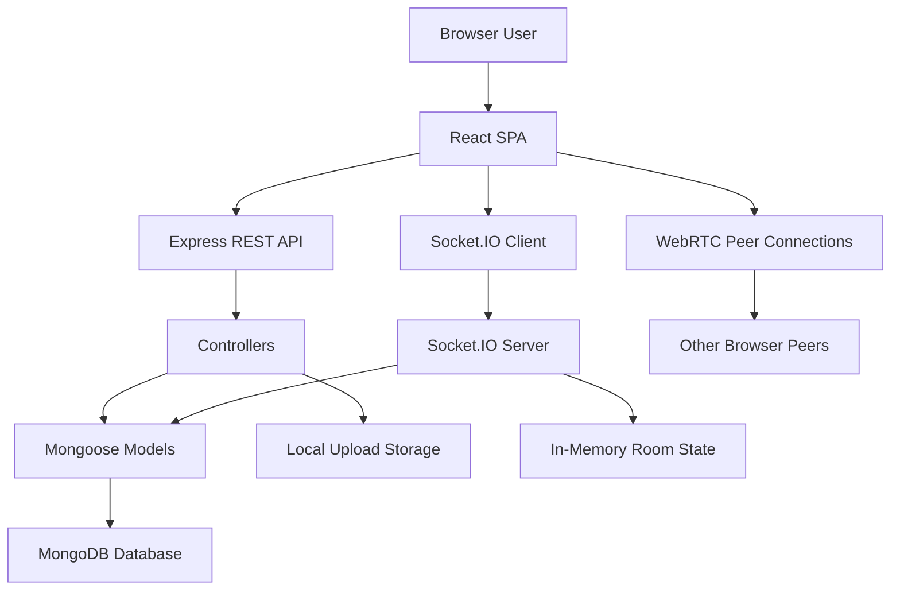
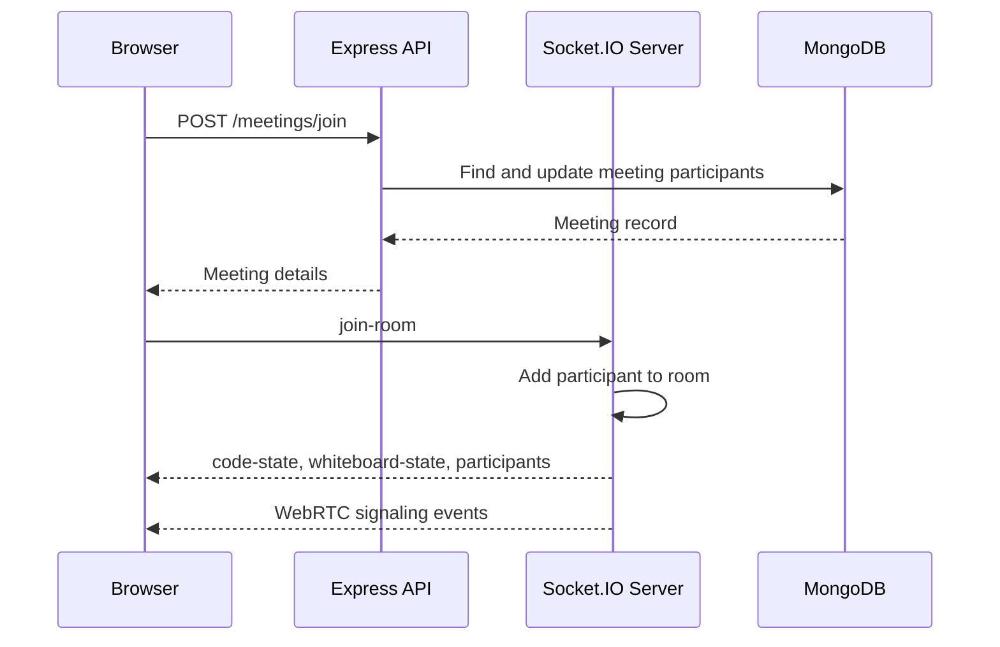

# Meetify Project Report

Prepared on: June 30, 2026

Project name: Meetify  
Project type: Full-stack web application  
Domain: Online meetings and real-time collaboration  
Architecture: MERN stack with WebRTC and Socket.IO

## Abstract

Meetify is a full-stack online meeting and collaboration platform designed to support real-time video communication, guest joining, meeting management, chat, file sharing, whiteboard collaboration, collaborative code editing, screen sharing, recording uploads, and meeting history. The system uses React and Vite for the frontend, Node.js and Express for the backend, MongoDB with Mongoose for persistence, Socket.IO for real-time room coordination, and WebRTC for peer-to-peer audio/video communication.

The project aims to provide a browser-based alternative to conventional meeting tools while adding collaboration-focused features such as a shared whiteboard and code editor. Meetify supports authenticated users as well as guest participants, making it suitable for team meetings, online learning, interviews, project discussions, and technical collaboration sessions.

## Table of Contents

1. Introduction
2. Problem Statement
3. Objectives
4. Scope
5. Proposed System
6. Technology Stack
7. System Architecture
8. Functional Requirements
9. Non-Functional Requirements
10. Module Description
11. Database Design
12. API Design
13. Real-Time Communication Design
14. Security Considerations
15. Testing and Validation
16. Deployment and Setup
17. Limitations
18. Future Enhancements
19. Conclusion
20. Appendix

## 1. Introduction

Online meetings have become a core part of education, business, software development, interviews, and remote collaboration. Many existing meeting tools focus mainly on video and audio communication, while teams often need multiple additional tools for chat, document sharing, whiteboarding, code review, and session history.

Meetify combines these meeting and collaboration features into one web application. It allows users to create or join meeting rooms, communicate through video and audio, exchange messages, share files, collaborate on a whiteboard, edit code together, and view meeting history after a session. The application is built as a modern single-page React frontend connected to an Express and MongoDB backend.

## 2. Problem Statement

Remote users need a reliable way to conduct live meetings while also collaborating through chat, shared files, whiteboards, code editing, and meeting records. Using separate tools for each activity can reduce productivity, increase context switching, and make it difficult to preserve meeting artifacts.

The problem addressed by Meetify is the development of a unified browser-based meeting platform that supports real-time communication, collaboration tools, participant controls, and persistent meeting history in a single application.

## 3. Objectives

The main objectives of Meetify are:

- Provide secure user registration, login, logout, and session handling.
- Allow authenticated users and guests to create and join meetings.
- Enable real-time audio and video communication using WebRTC.
- Use Socket.IO for signaling, participant state, chat, moderation, and collaborative events.
- Provide meeting controls such as microphone toggle, camera toggle, screen sharing, reactions, hand raise, participant removal, and mute controls.
- Support host and co-host moderation workflows.
- Provide optional waiting room support.
- Include public chat and private messages.
- Allow file sharing within meetings.
- Provide a shared whiteboard for visual collaboration.
- Provide a collaborative code editor with language selection and cursor awareness.
- Support meeting recordings through local browser capture with optional upload.
- Store meeting history, participants, chat, shared files, recordings, and activity logs.

## 4. Scope

Meetify focuses on browser-based meeting collaboration. The implemented scope includes:

- Frontend web interface for home, authentication, dashboard, guest join, live meeting, meeting history, and meeting details.
- REST APIs for authentication, meetings, chat history, file uploads, recording uploads, and user profile access.
- Real-time meeting room state through Socket.IO.
- WebRTC peer connections for audio and video streams.
- MongoDB data persistence through Mongoose models.
- Local static file serving for uploaded files and recordings.

Out of scope for the current implementation:

- Native desktop or mobile applications.
- Cloud storage integration for uploaded media.
- Email delivery for password reset OTPs.
- End-to-end encrypted meeting media and chat.
- Large-scale SFU/MCU media routing for high-participant meetings.

## 5. Proposed System

Meetify proposes a single integrated system where users can:

- Create instant or scheduled meetings.
- Join meetings with an account or as a guest.
- Use audio, video, chat, screen sharing, whiteboard, shared files, and code editor inside the same room.
- Let hosts manage participants and permissions.
- Persist meeting artifacts for later review.

The system uses a client-server model for application data and signaling. Media streams are exchanged using WebRTC peer connections, while the server coordinates rooms, participants, permissions, messages, whiteboard strokes, shared files, and code editor state.

## 6. Technology Stack

### Frontend

| Technology | Purpose |
| --- | --- |
| React 19 | Component-based user interface |
| Vite | Fast development server and frontend build tool |
| React Router | Client-side routing |
| Tailwind CSS | Utility-first styling |
| Axios | REST API communication |
| Socket.IO Client | Real-time event communication |
| Monaco Editor | Collaborative code editor interface |
| Framer Motion | Page and UI transitions |
| Lucide React | Icon system |

### Backend

| Technology | Purpose |
| --- | --- |
| Node.js | Server runtime |
| Express 5 | REST API framework |
| Socket.IO | Real-time room and signaling server |
| MongoDB | Database |
| Mongoose | Object data modeling |
| JWT | User authentication |
| bcryptjs | Password hashing |
| Multer | File and recording uploads |
| cookie-parser | HTTP-only cookie support |
| cors | Cross-origin frontend/backend communication |

### Development Tools

| Tool | Purpose |
| --- | --- |
| npm | Package management |
| concurrently | Run client and server together |
| nodemon | Backend development restart |
| ESLint | Frontend linting |

## 7. System Architecture

Meetify follows a layered full-stack architecture.



### Architecture Layers

| Layer | Description |
| --- | --- |
| Presentation Layer | React pages, layouts, reusable UI components, and meeting panels |
| Service Layer | Frontend API clients and socket client setup |
| API Layer | Express routes and controllers |
| Real-Time Layer | Socket.IO event handlers and WebRTC signaling |
| Persistence Layer | MongoDB collections for users, meetings, chat, files, recordings, and activity logs |
| Storage Layer | Local upload directories for shared files and recordings |

## 8. Functional Requirements

### User Management

- A user can register with name, email, password, and optional avatar.
- A user can log in and receive a JWT session.
- A user can log out and clear the authentication cookie.
- A user can request password reset through an OTP workflow.
- A user can view protected pages only after authentication.

### Meeting Management

- A user or guest can create a meeting.
- The system can generate a unique meeting ID.
- A participant can join a meeting using the meeting ID.
- The system stores meeting title, host, participants, status, schedule details, settings, and duration.
- Authenticated users can view recent meeting history.
- Authenticated users can view detailed meeting history if they hosted or joined the meeting.

### Real-Time Meeting

- Participants can join live meeting rooms.
- Participants can toggle microphone and camera.
- Participants can share screen when allowed.
- Participants can raise and lower hand.
- Participants can send reactions.
- Hosts and co-hosts can mute participants, mute all, remove users, make co-hosts, and end meetings.
- Waiting room participants can be approved or rejected.

### Collaboration Features

- Participants can send public chat messages.
- Participants can send private messages.
- Participants can upload and view shared files.
- Participants can open a shared file for synchronized viewing.
- Participants can draw on a shared whiteboard.
- Participants can clear or undo whiteboard strokes when permitted.
- Participants can collaborate in a shared code editor.
- The code editor stores code snapshots in the meeting record.

### Recording and History

- The host can start and stop a recording state.
- Browser recording can be saved locally or uploaded.
- Uploaded recordings are stored and linked to meeting history.
- Activity logs are stored for important meeting actions.

## 9. Non-Functional Requirements

| Requirement | Description |
| --- | --- |
| Usability | The UI should be simple enough for both registered users and guests. |
| Responsiveness | The frontend should work across common desktop and mobile viewport sizes. |
| Security | Passwords must be hashed and protected routes must require valid JWT authentication. |
| Reliability | Backend errors should return normalized JSON responses. |
| Maintainability | Code is organized into controllers, routes, models, services, components, hooks, and utilities. |
| Performance | Real-time room state is kept in memory for quick access during active meetings. |
| Compatibility | The meeting experience requires a modern browser with WebRTC support. |

## 10. Module Description

### 10.1 Frontend Application Module

The frontend is located in `client/src`. It is a React single-page application using route-based pages and reusable components.

Important frontend areas:

- `client/src/App.jsx`: Defines all application routes.
- `client/src/pages`: Contains route pages such as Home, Login, Register, Dashboard, Meeting, MeetingHistory, and MeetingDetails.
- `client/src/components`: Contains shared layout and UI components.
- `client/src/components/meeting`: Contains meeting room panels such as chat, files, whiteboard, code editor, participant list, host controls, video grid, and control bar.
- `client/src/context`: Provides authentication, theme, and toast state.
- `client/src/services`: Provides REST API clients and socket setup.
- `client/src/hooks/useWebRTC.js`: Coordinates media acquisition, peer connections, room events, meeting state, chat, files, whiteboard, code editor, and recording state.

### 10.2 Backend API Module

The backend is located in `server/src`. It exposes REST APIs and static upload serving.

Important backend areas:

- `server/src/app.js`: Configures Express middleware, CORS, routes, static uploads, and error handling.
- `server/src/server.js`: Creates the HTTP server, connects MongoDB, and registers Socket.IO.
- `server/src/routes`: Defines API endpoints.
- `server/src/controllers`: Handles API request logic.
- `server/src/middleware`: Contains authentication and error middleware.
- `server/src/models`: Defines MongoDB schemas.
- `server/src/utils`: Contains helpers for meeting ID normalization, token generation, and activity logging.

### 10.3 Authentication Module

Authentication uses JWT tokens generated on registration and login. The token is returned to the client and also stored as an HTTP-only cookie. The backend supports both cookie-based authentication and `Authorization: Bearer <token>` headers.

Passwords are hashed with bcrypt before storage. Protected routes use the `protect` middleware, while optional authentication routes use `optionalAuth` to support both registered users and guests.

### 10.4 Meeting Module

The meeting module supports creating, joining, retrieving, and reviewing meetings. Meetings can be instant or scheduled. Meeting records include the host, participants, status, settings, start time, end time, duration, notes, recording URL, and code snapshot.

### 10.5 Real-Time Communication Module

Socket.IO manages:

- Participant join and leave events.
- WebRTC signaling using offer, answer, and ICE candidate events.
- Participant state such as microphone, camera, hand raise, screen sharing, and role.
- Chat and private messaging.
- Waiting room requests and moderator decisions.
- Host controls and room permissions.
- Whiteboard strokes and code editor state.
- Shared file state and recording status.

### 10.6 WebRTC Module

WebRTC is used for browser-to-browser media transmission. The frontend creates `RTCPeerConnection` objects for remote participants. Socket.IO is used only for signaling, while actual audio/video media is exchanged through peer connections.

The system uses a public STUN server:

```js
stun:stun.l.google.com:19302
```

### 10.7 File and Recording Module

Shared files and recordings are uploaded through Multer. Files are stored under server upload directories and served statically through `/uploads`.

File upload restrictions include allowed document and image formats, with a 25 MB size limit for shared files. Recording upload restrictions include common audio/video formats, with a 500 MB size limit.

## 11. Database Design

Meetify uses MongoDB collections through Mongoose schemas.

### User Collection

| Field | Description |
| --- | --- |
| name | User display name |
| email | Unique login email |
| password | Hashed password, hidden by default |
| avatar | Optional avatar URL |
| role | User role, either user or admin |
| resetOtp | Password reset OTP, hidden by default |
| resetOtpExpire | OTP expiry timestamp |
| createdAt, updatedAt | Timestamps |

### Meeting Collection

| Field | Description |
| --- | --- |
| meetingId | Unique normalized meeting code |
| title | Meeting title |
| host | Host attendee object |
| participants | Joined participant records |
| status | waiting, live, or ended |
| isScheduled | Whether the meeting is scheduled |
| scheduledAt | Scheduled meeting time |
| startedAt | Actual start time |
| endedAt | End time |
| durationSeconds | Calculated duration |
| notes | Meeting notes |
| recordingUrl | Latest recording URL |
| settings | Meeting permission settings |
| codeSnapshot | Latest saved collaborative code state |
| createdAt | Creation timestamp |

### ChatMessage Collection

| Field | Description |
| --- | --- |
| meetingId | Meeting code |
| sender | Sender identity |
| receiver | Receiver identity for private messages |
| message | Chat content |
| type | text, file, emoji, or system |
| createdAt | Message timestamp |

### File Collection

| Field | Description |
| --- | --- |
| meetingId | Meeting code |
| uploadedBy | Uploader identity |
| fileName | Original filename |
| fileType | MIME type |
| fileUrl | Static file URL |
| size | File size in bytes |
| createdAt | Upload timestamp |

### Recording Collection

| Field | Description |
| --- | --- |
| meetingId | Meeting code |
| recordedBy | Recorder identity |
| fileName | Recording filename |
| fileType | MIME type |
| fileUrl | Static recording URL |
| size | File size in bytes |
| durationSeconds | Recording duration |
| createdAt | Upload timestamp |

### ActivityLog Collection

| Field | Description |
| --- | --- |
| meetingId | Meeting code |
| user | Actor identity |
| action | Activity description |
| timestamp | Event time |

## 12. API Design

Base API URL:

```text
http://localhost:5000/api
```

### Authentication APIs

| Method | Endpoint | Purpose |
| --- | --- | --- |
| POST | `/auth/register` | Register a user |
| POST | `/auth/login` | Log in a user |
| POST | `/auth/logout` | Log out a user |
| GET | `/auth/me` | Get current user |
| POST | `/auth/forgot-password` | Generate password reset OTP |
| POST | `/auth/verify-otp` | Verify password reset OTP |
| POST | `/auth/reset-password` | Reset password |

### Meeting APIs

| Method | Endpoint | Purpose |
| --- | --- | --- |
| POST | `/meetings/create` | Create a meeting |
| POST | `/meetings/join` | Join a meeting |
| GET | `/meetings/:meetingId` | Get public meeting details |
| GET | `/meetings/history` | Get authenticated user's meeting history |
| GET | `/meetings/history/:meetingId` | Get detailed meeting history |

### Chat, File, and Recording APIs

| Method | Endpoint | Purpose |
| --- | --- | --- |
| GET | `/chat/:meetingId` | Get chat history |
| POST | `/files/upload/:meetingId` | Upload a shared file |
| GET | `/files/:meetingId` | Get meeting files |
| POST | `/recordings/upload/:meetingId` | Upload a recording |
| GET | `/recordings/:meetingId` | Get meeting recordings |

### Health and User APIs

| Method | Endpoint | Purpose |
| --- | --- | --- |
| GET | `/health` | Service health check |
| GET | `/users/me` | Get authenticated user profile |

## 13. Real-Time Communication Design

Socket.IO events are used for room coordination and collaboration.

### Meeting Join Flow



### Important Socket Events

| Event | Purpose |
| --- | --- |
| `join-room` | Join a real-time meeting room |
| `update-participants` | Broadcast participant list |
| `offer` | Send WebRTC offer |
| `answer` | Send WebRTC answer |
| `ice-candidate` | Exchange ICE candidates |
| `toggle-mic` | Update microphone state |
| `toggle-camera` | Update camera state |
| `start-screen-share` | Start screen sharing state |
| `stop-screen-share` | Stop screen sharing state |
| `send-message` | Send public chat message |
| `private-message` | Send private chat message |
| `typing` | Broadcast typing indicator |
| `file-uploaded` | Notify room about shared file |
| `open-shared-file` | Synchronize opened file |
| `whiteboard-draw` | Broadcast whiteboard stroke |
| `whiteboard-clear` | Clear whiteboard |
| `whiteboard-undo` | Undo whiteboard stroke |
| `code-state` | Send current code editor state |
| `code-change` | Broadcast code changes |
| `language-change` | Broadcast editor language changes |
| `cursor-position` | Broadcast cursor location |
| `recording-started` | Broadcast recording start |
| `recording-stopped` | Broadcast recording stop |
| `end-meeting` | End room for all participants |

## 14. Security Considerations

Implemented security measures:

- Passwords are hashed using bcrypt before being stored.
- JWT authentication is used for protected routes.
- JWTs can be stored in HTTP-only cookies.
- Meeting history endpoints require authentication.
- Meeting history detail access is limited to the host or participants.
- Uploaded files are filtered by MIME type and extension.
- Upload sizes are limited.
- Whiteboard stroke data is sanitized before broadcasting.
- Code editor language values are restricted to an allowed set.
- CORS is configured through environment-aware origin handling.
- Backend error responses are centralized.

Security limitations:

- Password reset OTPs are logged to the server console instead of being emailed.
- Uploaded files are stored locally instead of using a hardened object storage service.
- WebRTC media is peer-to-peer and does not include additional application-level end-to-end encryption.
- No rate limiting is currently implemented for authentication or upload endpoints.
- No antivirus or malware scanning is currently implemented for uploads.

## 15. Testing and Validation

The project includes development commands for manual verification:

```bash
npm run install:all
npm run dev
npm run lint --prefix client
npm run build --prefix client
```

Recommended validation checklist:

- Register a new user.
- Log in and confirm dashboard access.
- Create an instant meeting.
- Join the same meeting from another browser or guest session.
- Verify camera, microphone, and participant list updates.
- Send public and private chat messages.
- Upload a supported file and confirm it appears in the file panel.
- Draw on the whiteboard and confirm remote synchronization.
- Edit code and change language in the collaborative editor.
- Test host controls such as mute, remove, make co-host, and end meeting.
- Upload or save a meeting recording.
- Review meeting history and meeting details after ending a meeting.

Current testing limitation:

- No dedicated automated backend or end-to-end test suite is present in the repository.

## 16. Deployment and Setup

### Requirements

- Node.js 20 or newer
- npm
- MongoDB local instance or hosted MongoDB database
- Modern browser with WebRTC support

### Environment Variables

Client:

```env
VITE_API_URL=http://localhost:5000/api
VITE_SOCKET_URL=http://localhost:5000
```

Server:

```env
NODE_ENV=development
PORT=5000
CLIENT_URL=http://localhost:5173
MONGO_URI=mongodb://127.0.0.1:27017/meetify
JWT_SECRET=replace-with-a-long-random-secret
JWT_EXPIRES_IN=7d
JWT_COOKIE_EXPIRES_IN=7
```

### Local Setup

Install dependencies:

```bash
npm run install:all
```

Run client and server together:

```bash
npm run dev
```

Default URLs:

| Service | URL |
| --- | --- |
| Frontend | `http://localhost:5173` |
| Backend API | `http://localhost:5000/api` |
| Static uploads | `http://localhost:5000/uploads/...` |

## 17. Limitations

- The system uses mesh-style WebRTC peer connections, which may not scale well for large meetings.
- Active room state is stored in memory, so it is lost when the server restarts.
- File and recording uploads are stored on local disk.
- OTP email delivery is mocked through console output.
- There is no automated test suite for API, socket, or UI workflows.
- The application does not currently include TURN server configuration for restrictive networks.
- Advanced administrative reporting and analytics are not implemented.

## 18. Future Enhancements

Recommended future improvements:

- Add TURN server support for better WebRTC connectivity.
- Introduce an SFU such as mediasoup or LiveKit for larger meetings.
- Store uploads and recordings in cloud object storage.
- Add real email delivery for password reset OTPs.
- Add rate limiting and stronger abuse protection.
- Add automated API, socket, and end-to-end browser tests.
- Add meeting invitations and calendar integration.
- Add transcript generation and searchable meeting summaries.
- Add role-based admin dashboard and analytics.
- Add persistent whiteboard history.
- Add notification system for waiting room and meeting invites.
- Add Docker configuration for repeatable deployment.
- Add CI/CD pipeline for linting, building, and deployment.

## 19. Conclusion

Meetify successfully demonstrates a complete real-time meeting and collaboration platform using modern web technologies. It combines user authentication, meeting creation, WebRTC audio/video, Socket.IO-based collaboration, chat, file sharing, whiteboard, code editing, recording uploads, and meeting history in a single full-stack application.

The project is organized clearly across frontend and backend layers, making it maintainable and extensible. While the current implementation is suitable for development, demonstrations, and small group collaboration, future improvements such as TURN/SFU support, cloud storage, automated testing, and production-grade security controls would make it stronger for large-scale deployment.

## 20. Appendix

### Project Structure

```text
Meetify/
  client/
    public/
      images/
    src/
      components/
        meeting/
        ui/
      context/
      hooks/
      lib/
      pages/
      services/
      App.jsx
      main.jsx
      styles.css
    package.json
    vite.config.js
    tailwind.config.js
  server/
    src/
      config/
      controllers/
      middleware/
      models/
      routes/
      socket/
      utils/
      app.js
      server.js
    package.json
    uploads/
  package.json
  README.md
  PROJECT_REPORT.md
```

### Key Source Files

| File | Purpose |
| --- | --- |
| `client/src/App.jsx` | Frontend route configuration |
| `client/src/hooks/useWebRTC.js` | Meeting state, WebRTC, socket events, chat, files, whiteboard, and code editor coordination |
| `client/src/components/meeting/MeetingRoom.jsx` | Main meeting room interface |
| `server/src/app.js` | Express app setup |
| `server/src/server.js` | HTTP server, MongoDB connection, and Socket.IO setup |
| `server/src/socket/index.js` | Real-time meeting, signaling, moderation, whiteboard, chat, file, and code events |
| `server/src/controllers/meetingController.js` | Meeting creation, joining, history, and detail logic |
| `server/src/models/Meeting.js` | Meeting schema |
| `server/src/models/User.js` | User schema and password hashing |

### Suggested Report Attachments

For academic or submission use, add screenshots for:

- Home page
- Login and registration pages
- Dashboard
- Guest join page
- Live meeting room
- Chat panel
- File sharing panel
- Whiteboard panel
- Code editor panel
- Meeting history page
- Meeting detail page

