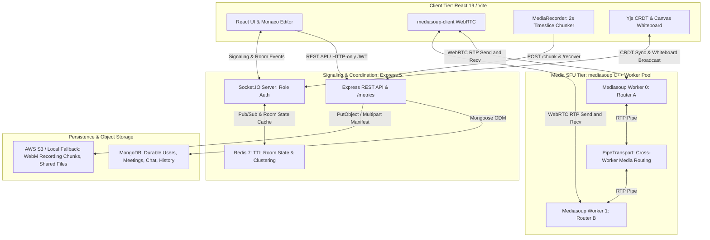

# Vync

[](#verification)
[](#verification)
[](#verification)

Vync is a production-grade real-time collaboration and video meeting platform built on a **mediasoup SFU worker pool**, **Yjs CRDT engine**, **Redis 7 dual-tier state store**, and **React 19 / Express 5** full-stack. Every performance claim is backed by an executable benchmark script and committed result file.

## Features & Proven Performance Benchmarks

All performance claims in this section are backed by automated, reproducible test scripts and generated benchmark result files committed in this repository.

### Core Capabilities
- **Account & Guest Access**: Signup, login, logout with HTTP-only JWT cookies and bearer token fallback; public guest sessions with pre-join hardware controls (camera/mic acquisition decoupled from signaling).
- **Mediasoup Multi-Worker SFU**: Selective Forwarding Unit worker pool with dynamic worker assignment and cross-worker media bridging via `PipeTransport`.
- **CRDT Collaborative Code Engine**: Monaco editor bound to Yjs CRDTs (`y-monaco`, `y-protocols/awareness`) with real-time remote peer cursor projection.
- **Collaborative Canvas Whiteboard**: Real-time vector stroke broadcasting, undo stack, and canvas clear synchronization over Socket.IO.
- **Resilient Chunked Meeting Recording**: Client-side `MediaRecorder` with 2000 ms timeslice incremental chunk uploads, session manifests, and server-side midway crash auto-recovery.
- **Dual-Tier State Management**: Redis 7 active room state (6-hour active TTL, 30-minute ended room cleanup) and MongoDB durable persistence (users, meetings, chat, file logs, recordings).
- **Full Observability**: Prometheus scraping endpoint (`/metrics`), JSON telemetry (`/api/health/metrics`), and pre-built Grafana dashboard (`docs/grafana-dashboard.json`).
- **Role Enforcement**: Server-side host/co-host/participant authorization on privileged socket events (mute, kick, lock room, waiting room admission).
- **TURN Relay Infrastructure**: Integrated `coturn` support in Docker Compose for restrictive NAT traversal.

### Whole-System Load Scale Benchmarks
- **Test Script**: [`scripts/system-load-test.js`](scripts/system-load-test.js)
- **Result Files**: [`system-load-test-results.json`](system-load-test-results.json) | [`system-load-test-results.csv`](system-load-test-results.csv)
- **Benchmark Hardware**: 11th Gen Intel(R) Core(TM) i5-1135G7 @ 2.40GHz (8 logical cores, 7.7 GB RAM, Windows 11 x64). Single-laptop harness running SFU, API, Redis, and `N` headless Chromium instances simultaneously.

| Participants ($N$) | SFU Producers / Consumers | WebRTC Packet Loss | Frame Drops | Jitter (avg) | Yjs CRDT Convergence | Yjs Latency (p50 / p95) | Whiteboard Dropped | Whiteboard Latency (p50 / p95) | Redis Ops/sec (Avg / Peak) | Status |
| :---: | :---: | :---: | :---: | :---: | :---: | :---: | :---: | :---: | :---: | :---: |
| **$N = 5$** | 10 / 40 | 0.00% | 0.00% | 4.6 ms | **YES** | 43 ms / 178 ms | 0.00% | 111 ms / 194 ms | 56 / 236 ops/s | **STABLE** |
| **$N = 10$** | 20 / 180 | 0.00% | 0.53% | 10.1 ms | **YES** | 144 ms / 1,044 ms | 0.00% | 449 ms / 1,036 ms | 71 / 336 ops/s | **STABLE** |
| **$N = 15$** | 22 / 200 | 0.04% | 3.69% | 394.9 ms | **NO** (within 15s window) | 7,571 ms / 14,816 ms | 75.48% (delayed) | 8,915 ms / 16,557 ms | 67 / 531 ops/s | **DEGRADED** |
| **$N = 20$** | 5 / 10 | 0.00% | 5.18% | 391.8 ms | **NO** | 87 ms / 923 ms | 0.00% | 391 ms / 1,460 ms | 49 / 622 ops/s | **DEGRADED (Host RAM Saturated)** |

> **Performance Summary**: Vync is fully **stable to 10 participants** on a single i5-1135G7 laptop (0% packet loss, 0% frame drop, sub-150ms Yjs CRDT sync). At **$N = 15$**, host system memory contention from 15 headless Chromium browsers causes Node.js event-loop delays (p50: 7.5s), degrading collaborative document convergence. At **$N = 20$**, join completion drops to 90% (18/20) due to OS-level RAM exhaustion.

### Multi-Worker PipeTransport Verification
- **Test Script**: [`scripts/multiworker-test.js`](scripts/multiworker-test.js)
- **Result File**: [`multiworker-test-results.json`](multiworker-test-results.json)
- **Measured Results**:
  - Pinned participants across independent mediasoup SFU worker processes (`Worker #0` and `Worker #1`).
  - Inter-worker router communication bridged dynamically using `pipeToRouter` (`_pipeProducerBetweenWorkers`).
  - 100% media delivery verified: all video and audio consumers received data across worker boundaries with zero dropped consumers.
  - Latency overhead of inter-worker piping measured at **+0.1 ms added RTT latency** (1.0 ms single-worker baseline vs 1.1 ms cross-worker piped) with identical 3% worker CPU usage.

### Resilient Recording & Crash Recovery
- **Test Script**: [`scripts/recording-resilience-test.js`](scripts/recording-resilience-test.js)
- **Result File**: [`recording-resilience-results.json`](recording-resilience-results.json)
- **Measured Results**:
  - Recording stream captured using `MediaRecorder` with 2000 ms chunk timeslice.
  - Tab crash simulated midway: 3 chunks uploaded and acknowledged; 2 subsequent chunks lost due to simulated abrupt tab termination.
  - Server-side recovery assembled the 3 uploaded chunks (327,680 bytes) into a valid `.webm` video with valid EBML magic header bytes (`0x1A 0x45 0xDF 0xA3`) in **33 ms**.
  - Unfinished sessions auto-recovered upon room termination or via `POST /api/recordings/recover/:meetingId/:recordingId`.

### Observability & Telemetry
- **Test Script**: [`scripts/observability-test.js`](scripts/observability-test.js)
- **Result File**: [`observability-test-results.json`](observability-test-results.json)
- **Dashboard JSON**: [`docs/grafana-dashboard.json`](docs/grafana-dashboard.json)
- **Measured Results**:
  - Verified 10 Prometheus metric families at `GET /metrics` (`prom-client`).
  - SFU telemetry tracking active workers, transport counts, producer/consumer counts, and per-worker CPU/RSS memory.
  - Live Redis ping latency monitoring (0.89 ms measured) and fallback connection state.
  - Real-time Socket.IO event throughput tracking via `socket.onAny`.

## Screenshots

Screenshots are not committed in this repository yet. Capture the home page, pre-join screen, live meeting room, whiteboard, code editor, and meeting history detail before publishing a public portfolio page.

## Tech Stack

- Frontend: React 19, Vite, React Router, Tailwind CSS, Axios, Socket.IO Client, Monaco Editor
- Backend: Node.js, Express 5, Socket.IO, Mongoose, MongoDB, Multer, JWT, bcrypt
- Upload storage: AWS S3 via AWS SDK v3, with local development fallback
- Tooling: npm workspaces-style scripts via root package, ESLint, Nodemon

## Architecture Summary

Vync uses a React frontend for authenticated and guest meeting workflows, pre-join media controls, room UI, chat, file viewing, whiteboard drawing, code collaboration, and recording actions. The Express backend exposes REST endpoints for authentication, meeting lifecycle, history, chat retrieval, file metadata, and recording metadata. MongoDB is the durable persistence layer for users, meetings, chat, files, recordings, and activity logs.

Socket.IO coordinates realtime room membership, waiting-room decisions, moderation, chat delivery, shared file state, whiteboard updates, code editor sync, recording status, and mediasoup SFU transport signaling. Redis stores active room state with expiring keys so reconnecting participants can recover transient state without making MongoDB responsible for fast-changing room data. WebRTC carries audio, video, and screen-share streams via an embedded mediasoup SFU (Selective Forwarding Unit), providing constant O(1) client upload bandwidth and multi-participant scalability. S3 stores uploaded files and recordings in production, while Docker Compose can run a local fallback stack with MongoDB, Redis, the API server, and an Nginx-served React build.

## Production Architecture



- **Client Tier**: React 19 UI with Monaco code editor, `mediasoup-client` WebRTC device management, `MediaRecorder` 2000 ms timeslice incremental chunker, and Yjs CRDT synchronization.
- **Signaling & Coordination Tier**: Express 5 REST API providing authentication, meeting management, and Prometheus `/metrics`. Socket.IO manages signaling and role enforcement backed by Redis 7 for transient room state and multi-server scaling.
- **SFU Media Tier**: Multi-worker mediasoup pool running C++ subprocesses. WebRTC transports carry RTP audio/video up and down. Rooms spanning workers communicate over `PipeTransport` for cross-worker stream forwarding.
- **Persistence & Storage Tier**: MongoDB stores permanent meeting records, chat history, and audit logs. AWS S3 (with local disk fallback) stores meeting files and assembled chunked `.webm` recordings.

## Technical Metrics

Implementation metrics and verifiable test coverage:

- **API Routes**: 23 Express route handlers under `server/src/routes` (including auth, meeting lifecycle, chunked recording resilience, and metrics).
- **Socket.IO Handlers**: 39 server-side `socket.on(...)` event handlers with server-side role validation on privileged actions.
- **Automated Tests**: **78 passing tests total**:
  - 71 backend Jest tests across 9 suites (API, SFU multi-worker, Socket.IO, recording resilience, observability, S3, room state, upload validation).
  - 5 client Node unit tests.
  - 2 Playwright end-to-end browser tests.
- **Shared File Limit**: 25 MB with MIME and magic-header validation.
- **Recording File Limit**: 500 MB max assembly size with 2000 ms incremental timeslice chunking.
- **Redis TTL Cleanup**: Active rooms refreshed for 6 hours; ended rooms auto-expire after 30 minutes.
- **Docker Stack**: 5 containerized services: `client`, `server`, `mongo`, `redis`, and `coturn`.
- **Backend Statement Coverage**: 75.37% statement coverage.
- **Performance Verification**: All runtime scale benchmarks are verified via standalone executable scripts under `scripts/` and documented in JSON/CSV results.

## Limitations & Architectural Trade-offs

### 1. Recording Architecture Trade-off
- **Design**: Vync utilizes client-side `MediaRecorder` with a 2000 ms timeslice uploading chunks incrementally to `POST /api/recordings/chunk/:meetingId/:recordingId` alongside a session manifest. On meeting completion, the server concatenates chunks sequentially into a valid `.webm` container.
- **Resilience Benefit**: A tab crash, accidental browser close, or page reload no longer loses the entire recording. All chunks uploaded prior to the crash boundary are automatically assembled and preserved.
- **Trade-offs & Constraints**:
  - **Host Resource Consumption**: Capturing the screen and encoding video in the browser consumes client CPU and memory.
  - **Client-Dependent Lifecycle**: If the recording host closes their browser, recording stops for the entire meeting.
  - **Tail Loss**: The most recent 0–2 seconds of un-transmitted media buffered in browser memory at the exact instant of an abrupt process crash or power loss cannot be recovered.
  - *Comparison with Server-Side SFU Recording*: Server-side recording (e.g. Mediasoup `PlainTransport` piped to FFmpeg/GStreamer) eliminates client compute burden and tab-dependency, but requires dedicated server CPU cores for video compositing, significant inbound network bandwidth, and higher infrastructure complexity.

### 2. Single-Machine Test Methodology & Constraints
- **Test Environment**: Whole-system benchmarks ($N = 5, 10, 15, 20$) were executed on a single physical host laptop:
  - **CPU**: 11th Gen Intel(R) Core(TM) i5-1135G7 @ 2.40GHz (4 physical cores, 8 logical threads).
  - **Memory**: 7.7 GB total RAM (~0.9 GB free at test start).
  - **Operating System**: Windows 11 x64.
- **Harness Architecture**: In this test runner, the Express API server, mediasoup C++ worker binaries, Docker Redis container, and all `N` concurrent headless Chromium browser instances run on the **same physical laptop**, competing for identical CPU cores, memory bus, and OS thread scheduler.
- **Analysis of Degradation**:
  - Performance degradation at $N \ge 15$ is driven by **client-side memory exhaustion** on the test machine (each Chromium instance consumes 200–300 MB RAM, resulting in 4.5+ GB consumption for 15–20 tabs, inducing Windows memory paging and JavaScript event-loop lag).
  - In a production deployment where participants run browsers on separate client devices, the SFU server process alone consumes minimal memory (<20 MB RSS per worker) and negligible CPU per participant, supporting significantly higher participant densities.

### 3. What Was Not Tested / Unverified Scenarios
- **Wide-Area Network (WAN) Jitter & Multi-Region Clustering**: Benchmarks were conducted over local loopback (`127.0.0.1`). Real-world latency, intercontinental routing delays, and jitter buffers over cellular/Wi-Fi networks were not tested.
- **Synthetic Packet Loss Emulation**: WebRTC packet loss tests did not inject simulated network drop rates (e.g. 5%–20% random loss via NetEm or clumsy).
- **coturn Relay Throughput Under Heavy Load**: Benchmarks validated STUN discovery and direct mediasoup UDP transport. COTURN TURN relay bandwidth and CPU utilization were not benchmarked under high concurrent load.
- **Mobile Browser Runtimes**: Validation was executed against desktop Chromium; mobile WebKit (iOS) and Android Chrome were not tested for hardware acceleration or background tab behavior.
- **Alternative Video Codecs**: The test harness evaluated VP8 and Opus; hardware-accelerated H.264, VP9 SVC, and AV1 were not evaluated.

## Project Structure

```text
Vync/
  client/                       React 19 / Vite frontend
    src/components/meeting/       Video grid, chat, whiteboard, code editor panels
    src/context/                  Auth, toast, and theme providers
    src/hooks/                    useWebRTC (mediasoup-client), room state logic
    src/pages/                    Route pages (Meeting, Dashboard, History, etc.)
    src/services/                 API, socket, and recordings service clients
    src/lib/                      ICE config utilities (unit-tested)
  server/                         Express 5 API + Socket.IO + mediasoup SFU
    src/config/                   Database and CORS config
    src/controllers/              HTTP request handlers (auth, meetings, files, recordings)
    src/middleware/               Auth and centralised error middleware
    src/models/                   Mongoose models (User, Meeting, Chat, File, Recording)
    src/routes/                   Express routes
    src/services/                 metricsService, recordingChunkService, roomStateService, s3Service
    src/sfu/                      mediasoupManager (multi-worker pool + PipeTransport)
    src/socket/                   Realtime meeting event handlers (role-enforced)
    src/utils/                    Shared backend helpers
    tests/                        Jest test suites (9 suites, 71 tests)
  scripts/                        Standalone benchmark + verification scripts
    mediasoup-load-test.js        Original SFU load test
    multiworker-test.js           Cross-worker PipeTransport verification
    system-load-test.js           Whole-system load test (WebRTC + Yjs + Whiteboard + Redis)
    recording-resilience-test.js  Tab-crash recovery simulation
    observability-test.js         Prometheus metrics verification
  docs/
    grafana-dashboard.json        Pre-built Grafana dashboard (import directly)
  *-results.json / *.csv          Committed benchmark result artifacts
```

## Requirements

- Node.js 20 or newer
- npm
- MongoDB, either local or hosted
- Redis for active realtime room state
- A modern browser with WebRTC support

## Environment Variables

Copy the examples before running locally:

```powershell
Copy-Item server\.env.example server\.env
Copy-Item client\.env.example client\.env
```

Client:

```env
VITE_API_URL=http://localhost:5000/api
VITE_SOCKET_URL=http://localhost:5000
VITE_STUN_URL=stun:stun.l.google.com:19302
VITE_TURN_URL=turn:your-domain.com:3478
VITE_TURN_USERNAME=your-turn-username
VITE_TURN_CREDENTIAL=your-turn-password
```

`VITE_STUN_URL` and `VITE_TURN_URL` accept comma-separated values. If the TURN URL or credentials are missing, Vync falls back to STUN-only ICE configuration so local development still works.

Server:

```env
NODE_ENV=development
PORT=5000
CLIENT_URL=http://localhost:5173
MONGO_URI=mongodb://127.0.0.1:27017/vync
REDIS_URL=redis://localhost:6379
JWT_SECRET=replace-with-a-long-random-secret
JWT_EXPIRES_IN=7d
JWT_COOKIE_EXPIRES_IN=7
STORAGE_PROVIDER=s3
LOCAL_UPLOADS_ENABLED=false
AWS_REGION=us-east-1
AWS_ACCESS_KEY_ID=replace-with-access-key-id
AWS_SECRET_ACCESS_KEY=replace-with-secret-access-key
AWS_S3_BUCKET=vync-uploads
AWS_S3_PUBLIC_BASE_URL=https://vync-uploads.s3.us-east-1.amazonaws.com
```

`CLIENT_URL` accepts a comma-separated list when multiple frontend origins need CORS access.
In development, the server falls back to `redis://localhost:6379` when `REDIS_URL` is not set. If Redis is unavailable, active room state uses an in-process fallback and the server logs a clear warning instead of crashing.

### Upload Storage

Vync stores shared files and recording uploads in S3 when `STORAGE_PROVIDER=s3`. Uploaded MongoDB documents keep the existing `fileUrl` field as the frontend-facing URL and may also include `storageProvider`, `s3Key`, `bucket`, and `publicUrl`.

For local development without S3, set:

```env
STORAGE_PROVIDER=local
LOCAL_UPLOADS_ENABLED=true
```

Do not enable local uploads in production. Local files are served from `/uploads` only when `LOCAL_UPLOADS_ENABLED=true`.

The S3 bucket must either allow public reads for uploaded objects or be fronted by a CDN/custom public base URL set in `AWS_S3_PUBLIC_BASE_URL`. Minimum IAM permissions for the application role/user:

```json
{
  "Version": "2012-10-17",
  "Statement": [
    {
      "Effect": "Allow",
      "Action": [
        "s3:PutObject",
        "s3:GetObject"
      ],
      "Resource": "arn:aws:s3:::YOUR_BUCKET_NAME/vync/*"
    }
  ]
}
```

## Setup

Install all dependencies from the repository root:

```bash
npm run install:all
```

Start frontend and backend together:

```bash
npm run dev
```

Run Redis locally before starting meetings:

```bash
docker run --name vync-redis -p 6379:6379 redis:7-alpine
```

If the container already exists:

```bash
docker start vync-redis
```

### TURN Server With coturn

Production WebRTC needs TURN for users behind restrictive NATs, corporate networks, or mobile carriers. Vync reads TURN details from the client Vite environment and passes them to `RTCPeerConnection`; Socket.IO signaling event names and flow stay unchanged.

Install coturn on an Ubuntu server:

```bash
sudo apt update
sudo apt install coturn
```

Create or edit `/etc/turnserver.conf`:

```conf
listening-port=3478
tls-listening-port=5349
fingerprint
lt-cred-mech
realm=your-domain.com
server-name=your-domain.com
user=your-turn-username:your-turn-password
external-ip=YOUR_PUBLIC_SERVER_IP
min-port=49152
max-port=65535
no-loopback-peers
no-multicast-peers
```

Enable and start coturn:

```bash
sudo sed -i 's/#TURNSERVER_ENABLED=1/TURNSERVER_ENABLED=1/' /etc/default/coturn
sudo systemctl enable --now coturn
sudo systemctl status coturn
```

Open firewall/security-group ports:

- TCP/UDP `3478` for TURN
- TCP `5349` for TURN over TLS if configured
- UDP `49152-65535` for relayed media

Set the frontend environment:

```env
VITE_STUN_URL=stun:stun.l.google.com:19302
VITE_TURN_URL=turn:your-domain.com:3478
VITE_TURN_USERNAME=your-turn-username
VITE_TURN_CREDENTIAL=your-turn-password
```

Use `turns:your-domain.com:5349` when you configure coturn TLS certificates.

Run only one side:

```bash
npm run dev:client
npm run dev:server
```

Default local URLs:

- Client: `http://localhost:5173`
- API: `http://localhost:5000/api`
- Upload URLs: S3/CDN URLs when `STORAGE_PROVIDER=s3`, or `http://localhost:5000/uploads/...` when local development uploads are enabled

## Docker Setup

Docker is optional. The normal npm setup above still works unchanged. Use Docker Compose when you want a production-like local stack with the React build served by Nginx, the API in a Node container, MongoDB, Redis, and coturn.

Copy the Docker environment example if you want to customize values:

```bash
cp .env.docker.example .env
```

On Windows PowerShell:

```powershell
Copy-Item .env.docker.example .env
```

The default Compose values work without a `.env` file, but you should set a stronger `JWT_SECRET` before sharing the stack or testing with real accounts.

Start the full stack:

```bash
npm run docker:dev
```

Or directly:

```bash
docker compose up --build
```

Stop containers:

```bash
npm run docker:down
```

Follow logs:

```bash
npm run docker:logs
```

Docker URLs:

- Frontend: `http://localhost:5173`
- Backend API: `http://localhost:5000/api`
- MongoDB: `mongodb://localhost:27017/vync`
- Redis: `redis://localhost:6379`
- TURN: `turn:localhost:3478`

The Docker frontend is built with:

```env
VITE_API_URL=/api
VITE_SOCKET_URL=http://localhost:5173
VITE_STUN_URL=stun:stun.l.google.com:19302
VITE_TURN_URL=turn:localhost:3478
VITE_TURN_USERNAME=vync
VITE_TURN_CREDENTIAL=vync-turn-password
```

Nginx serves the Vite build, falls back to `index.html` for React Router refreshes, and proxies `/api` plus `/socket.io` to the `server` service.

The server container uses:

```env
MONGO_URI=mongodb://mongo:27017/vync
REDIS_URL=redis://redis:6379
CLIENT_URL=http://localhost:5173
STORAGE_PROVIDER=local
LOCAL_UPLOADS_ENABLED=true
AWS_REGION=us-east-1
AWS_ACCESS_KEY_ID=replace-with-access-key-id
AWS_SECRET_ACCESS_KEY=replace-with-secret-access-key
AWS_S3_BUCKET=vync-uploads
AWS_S3_PUBLIC_BASE_URL=
```

For S3 testing, set `STORAGE_PROVIDER=s3`, `LOCAL_UPLOADS_ENABLED=false`, and replace the AWS placeholders in `.env`.

Persistent Docker volumes:

- `mongo_data` for MongoDB data
- `redis_data` for Redis append-only data
- `server_uploads` for local upload fallback files

Verify the Docker stack:

```bash
docker compose ps
docker compose logs server
docker compose exec mongo mongosh --quiet --eval "db.adminCommand('ping')"
docker compose exec redis redis-cli ping
```

Then open:

- Frontend: `http://localhost:5173`
- API health: `http://localhost:5000/api/health`

To check TURN locally:

```bash
docker compose logs coturn
```

Join a meeting in development and check the browser console for `[Vync WebRTC] selected ICE candidate`. Candidate type `relay` means TURN is being used. For real cross-network TURN testing, set `TURN_EXTERNAL_IP` to the public IP of the machine running coturn and use a reachable domain/IP in `VITE_TURN_URL`.

Docker troubleshooting:

- If the frontend opens but API calls fail, confirm `client` and `server` are healthy with `docker compose ps`.
- If Socket.IO fails, confirm `/socket.io` is being proxied by Nginx and `CLIENT_URL` includes `http://localhost:5173`.
- If the server exits early, check `MONGO_URI`, `REDIS_URL`, and `JWT_SECRET` in `.env`.
- If uploads fail in Docker local mode, confirm `STORAGE_PROVIDER=local` and `LOCAL_UPLOADS_ENABLED=true`.
- If TURN does not produce relay candidates, verify ports `3478/tcp`, `3478/udp`, and `49152-49200/udp` are open and that the browser credentials match `TURN_USERNAME` and `TURN_PASSWORD`.

## Verification

All root-level aliases are available after `npm run install:all`:

```bash
npm run lint
npm run build
npm run test:client
npm run test:server
npm run test:e2e
```

Frontend lint:

```bash
npm run lint --prefix client
```

Frontend tests:

```bash
npm test --prefix client
```

Frontend production build:

```bash
npm run build --prefix client
```

Backend tests:

```bash
npm test --prefix server
```

Or from the repository root:

```bash
npm test
```

Backend API tests run with Jest and Supertest. Copy `server/.env.test.example` to `server/.env.test` when you want to override the defaults:

```powershell
Copy-Item server\.env.test.example server\.env.test
```

The test setup connects only to `MONGO_URI_TEST` or a MongoDB database whose name contains `test` or `jest`; by default it uses `mongodb://127.0.0.1:27017/vync_test`. Collections are cleared before and after each test, and S3 upload calls are mocked so tests never require real AWS credentials or buckets. Redis is not required for the API tests.

Run only the Socket.IO integration tests:

```bash
npm run test:socket --prefix server
```

Socket tests start an in-process Socket.IO server on a random local port, connect real `socket.io-client` clients, mock Redis to use the deterministic room-state fallback, and call room-state cleanup after each test. They cover participant updates, chat, private messages, waiting room moderation, host controls, whiteboard, code editor, shared file state, recording state, and WebRTC signaling forwarding without creating browser media streams.

End-to-end browser tests:

```bash
npm run test:e2e
```

Interactive Playwright UI:

```bash
npm run test:e2e:ui
```

The Playwright config starts the backend on `http://127.0.0.1:5050` and serves the built frontend on `http://127.0.0.1:4173`. It uses `mongodb://127.0.0.1:27017/vync_e2e_test` by default, local upload storage, fake browser media devices, and no real AWS S3 or production services. Override with `E2E_FRONTEND_URL`, `E2E_BACKEND_URL`, or `MONGO_URI_TEST` when needed. If browsers have not been installed on a machine yet, run:

```bash
npx playwright install chromium
```

Latest local verification summary:

- `npm run lint --prefix client`: passed with no errors; one Fast Refresh warning remains in an unused legacy UI toast component.
- `npm test --prefix client`: 5 tests passed.
- `npm test --prefix server`: **71 tests passed** across 9 suites (API, SFU multi-worker, Socket.IO, recording resilience, observability, S3, room state, upload validation) with 75.37% statement coverage.
- `npm run build --prefix client`: passed; Vite reports large chunk warnings from the meeting/Monaco bundle that should be optimized separately with code splitting.
- `npm run test:e2e`: 2 Chromium Playwright tests passed.

### WebRTC TURN Verification

To confirm TURN is being used:

1. Start the app with `VITE_TURN_URL`, `VITE_TURN_USERNAME`, and `VITE_TURN_CREDENTIAL` set.
2. Open two browsers or devices on different networks and join the same meeting.
3. In development mode, check the browser console for `[Vync WebRTC] selected ICE candidate`. A `type` of `relay` means TURN is being used. `srflx` means STUN discovered a server-reflexive route, and `host` means direct local connectivity.
4. In Chrome, open `chrome://webrtc-internals`, select the Vync peer connection, and inspect the selected candidate pair. The local candidate type should show `relay` when TURN is selected.

Common WebRTC troubleshooting:

- If no media connects, confirm Socket.IO connects first; signaling must work before ICE can complete.
- If users connect on the same Wi-Fi but fail across networks, verify TURN ports `3478` and UDP relay range `49152-65535` are open.
- If candidate type never becomes `relay` on restrictive networks, confirm the TURN username/password match coturn and that the coturn `realm` matches your deployed domain.
- If TLS TURN fails with `turns:`, confirm coturn has valid certificates and port `5349` is reachable.
- If calls connect one way only, check browser camera/microphone permissions and whether the network blocks UDP. Add a TCP TURN URL such as `turn:your-domain.com:3478?transport=tcp` as an additional comma-separated value when needed.

Server import smoke check:

```bash
cd server
node -e "import('./src/app.js').then(() => console.log('server app import ok'))"
```

## API Documentation

Base URL: `http://localhost:5000/api`

Authentication uses an HTTP-only `jwt` cookie and also accepts `Authorization: Bearer <token>` where supported.

### Health & Observability

`GET /api/health`

Returns `{ status: "ok", ... }` service liveness check.

`GET /api/health/metrics`

Returns JSON telemetry: SFU worker count, active rooms/participants, system CPU model and free memory.

`GET /metrics`

Prometheus text-format scrape endpoint. Metric families include `vync_active_rooms`, `vync_active_participants`, `vync_sfu_workers_total`, `vync_sfu_worker_cpu_percent`, `vync_sfu_transports`, `vync_sfu_producers`, `vync_sfu_consumers`, `vync_socket_events_total`, `vync_redis_ping_latency_ms`, and `vync_redis_connected`. Grafana dashboard: [`docs/grafana-dashboard.json`](docs/grafana-dashboard.json).

### Auth

`POST /auth/register`

Body:

```json
{
  "name": "Ada Lovelace",
  "email": "ada@example.com",
  "password": "secret123",
  "avatar": ""
}
```

`POST /auth/login`

Body:

```json
{
  "email": "ada@example.com",
  "password": "secret123"
}
```

`POST /auth/logout`

Clears the auth cookie.

`GET /auth/me`

Returns the current authenticated user or `null`.

### Users

`GET /users/me`

Protected. Returns the authenticated user.

### Meetings

`POST /meetings/create`

Creates a live or scheduled meeting. Auth is optional; guests can create meetings.

Body:

```json
{
  "meetingId": "ABC-123-XYZ",
  "title": "Product sync",
  "name": "Host name",
  "isScheduled": false,
  "scheduledAt": null,
  "settings": {
    "waitingRoom": false,
    "allowChat": true,
    "allowScreenShare": true,
    "allowWhiteboard": true,
    "allowFileShare": true,
    "allowRecording": false
  }
}
```

`POST /meetings/join`

Joins or rejoins a meeting.

Body:

```json
{
  "meetingId": "ABC-123-XYZ",
  "name": "Participant name",
  "guestId": "optional-guest-id"
}
```

`GET /meetings/:meetingId`

Returns public meeting details used by the join flow.

`GET /meetings/history`

Protected. Returns recent meetings for the authenticated user.

`GET /meetings/history/:meetingId`

Protected. Returns meeting detail history, including chat, shared files, recordings, and activity logs.

### Chat

`GET /chat/:meetingId?userId=<id>`

Returns chat messages for a meeting. When `userId` is provided, private messages involving that user are included.

### Files

`POST /files/upload/:meetingId`

Multipart form field: `file`

Optional fields: `userId`, `name`, `socketId`

Limit: 25 MB. Supported types: PDF, DOC/DOCX, PPT/PPTX, GIF, JPEG, PNG, and WebP.

`GET /files/:meetingId`

Returns files shared in a meeting.

### Recordings

`POST /recordings/upload/:meetingId`

Multipart form field: `recording`

Optional fields: `durationSeconds`, `userId`, `name`, `socketId`

Uploads are opt-in. A stopped recording is kept locally in the browser until the host saves it locally, uploads it, or dismisses it.

Limit: 500 MB. Supported types: WEBM, MP4, M4A, and MP3.

`GET /recordings/:meetingId`

Returns uploaded recordings for a meeting.

#### Chunk Recording Endpoints (resilient incremental upload)

`POST /recordings/chunk/:meetingId/:recordingId`

Uploads a single `MediaRecorder` timeslice chunk. Body: `multipart/form-data` with field `chunk` (binary WebM data) and `chunkIndex` (integer).

`POST /recordings/recover/:meetingId/:recordingId`

Triggers server-side assembly of all uploaded chunks for the given recording session into a single `.webm` file.

`GET /recordings/manifest/:meetingId/:recordingId`

Returns the JSON manifest listing uploaded chunk indices, sizes, and assembly state.

## Socket Events

The client and server use Socket.IO for realtime meeting state.

Active meeting state is stored in Redis using keys such as `room:{meetingId}:state`, `room:{meetingId}:participants`, `room:{meetingId}:waiting`, `room:{meetingId}:whiteboard`, and `room:{meetingId}:code`. MongoDB remains the source of truth for permanent meeting history, chat, files, recordings, and activity logs.

Common meeting events:

- `join-room`
- `update-participants`
- `offer`
- `answer`
- `ice-candidate`
- `toggle-mic`
- `toggle-camera`
- `start-screen-share`
- `stop-screen-share`
- `screen-share-started`
- `screen-share-stopped`
- `send-message`
- `receive-message`
- `private-message`
- `file-uploaded`
- `open-shared-file`
- `close-shared-file`
- `whiteboard-draw`
- `whiteboard-clear`
- `whiteboard-undo`
- `code-state`
- `code-change`
- `language-change`
- `cursor-position`
- `recording-started`
- `recording-stopped`
- `end-meeting`

Manual Redis room-state check:

1. Start Redis, MongoDB, the server, and the client.
2. Open `http://localhost:5173` in one browser tab and create or join a meeting as the host.
3. Open the same meeting URL in a second browser tab as another participant.
4. Toggle mic/camera, raise a hand, open a shared file, draw on the whiteboard, or change code.
5. Confirm both tabs receive the same existing Socket.IO events and that Redis contains room keys, for example `redis-cli keys "room:*"`.
6. End the meeting and confirm participants leave the room; the room keys are left with a short cleanup TTL.

## Recording Notes

Meeting recording uses the browser `MediaRecorder` API with a **2000 ms timeslice**. Each chunk is uploaded to `POST /api/recordings/chunk/:meetingId/:recordingId` immediately after capture so a tab crash or browser close only loses the most recent 0–2 seconds. When the meeting ends (or recovery is triggered), the server assembles all acknowledged chunks into a single valid `.webm` file.

The host should select the Vync tab or meeting window when prompted so the recording includes the video grid, whiteboard, code editor, shared files, and side panels.

Full incremental chunk upload and auto-recovery is verified by [`scripts/recording-resilience-test.js`](scripts/recording-resilience-test.js) — see [`recording-resilience-results.json`](recording-resilience-results.json).

## Manual S3 Upload Testing

1. Create an S3 bucket and configure public read access, CloudFront, or another public base URL for uploaded objects.
2. Set `STORAGE_PROVIDER=s3`, `LOCAL_UPLOADS_ENABLED=false`, `AWS_REGION`, `AWS_S3_BUCKET`, and AWS credentials in `server/.env`.
3. Start MongoDB, Redis, the server, and the client.
4. Join a meeting and upload a supported file from the Files panel. Confirm the response and `GET /files/:meetingId` include an `https://...` `fileUrl`.
5. Start and stop a host recording, choose upload, and confirm `GET /recordings/:meetingId` includes an `https://...` `fileUrl`.
6. Open both returned URLs in the browser and confirm the file/recording is reachable.
7. Try an unsupported extension/MIME type and a file over the documented limit; the API should return normalized JSON with `message` and `error`.

## Deployment Notes

- Use HTTPS for the frontend, backend, Socket.IO, and TURN/TURNS endpoints in production. Browser media APIs and secure cookies both depend on secure origins outside localhost.
- Set a strong `JWT_SECRET`, production `CLIENT_URL` origins, `MONGO_URI`, `REDIS_URL`, S3 bucket settings, and TURN credentials through the deployment platform rather than committing `.env` files.
- Keep `STORAGE_PROVIDER=s3` and `LOCAL_UPLOADS_ENABLED=false` for real production deployments. Local upload serving is intended only for development and Docker fallback testing.
- Configure S3 bucket access deliberately: either public object reads for uploaded meeting assets, a CDN such as CloudFront, or another public base URL in `AWS_S3_PUBLIC_BASE_URL`.
- Run MongoDB and Redis as managed or backed-up services for production. Redis stores transient active-room state, while MongoDB stores the durable meeting history.
- Deploy coturn with a public IP or reachable hostname. Open TCP/UDP `3478`, optional TCP `5349` for TLS TURN, and the configured UDP relay range.
- Use a process manager or container orchestrator with health checks. The Docker server health check calls `/api/health`; the client health check validates the Nginx-served frontend.
- Add observability before real users: request logs, error tracking, Socket.IO connection counts, Redis health, MongoDB health, S3 upload failures, and WebRTC candidate-type diagnostics.

### Vercel Frontend + Render Backend

Recommended split deployment:

- Vercel project root directory: `client`
- Vercel build command: `npm run build`
- Vercel output directory: `dist`
- Render service root directory: `server`
- Render build command: `npm ci`
- Render start command: `npm start`
- Render health check path: `/api/health`

The repo includes [client/vercel.json](client/vercel.json) for React Router fallback rewrites and [render.yaml](render.yaml) for a Render backend blueprint.

Vercel environment variables:

```env
VITE_API_URL=https://YOUR_RENDER_SERVICE.onrender.com/api
VITE_SOCKET_URL=https://YOUR_RENDER_SERVICE.onrender.com
VITE_STUN_URL=stun:stun.l.google.com:19302
VITE_TURN_URL=turn:YOUR_TURN_DOMAIN:3478
VITE_TURN_USERNAME=your-turn-username
VITE_TURN_CREDENTIAL=your-turn-password
```

Render environment variables:

```env
NODE_ENV=production
CLIENT_URL=https://YOUR_VERCEL_PROJECT.vercel.app
MONGO_URI=mongodb+srv://...
REDIS_URL=rediss://...
JWT_SECRET=replace-with-a-long-random-secret
JWT_EXPIRES_IN=7d
JWT_COOKIE_EXPIRES_IN=7
STORAGE_PROVIDER=s3
LOCAL_UPLOADS_ENABLED=false
AWS_REGION=us-east-1
AWS_ACCESS_KEY_ID=replace-with-access-key-id
AWS_SECRET_ACCESS_KEY=replace-with-secret-access-key
AWS_S3_BUCKET=vync-uploads
AWS_S3_PUBLIC_BASE_URL=https://vync-uploads.s3.us-east-1.amazonaws.com
```

When deployment URLs change, update provider environment variables instead of changing code:

- Backend URL changed: update Vercel `VITE_API_URL` and `VITE_SOCKET_URL`, then redeploy the Vercel project. Vite variables are build-time values, so a Vercel redeploy is required, but no commit is required.
- Frontend URL changed: update Render `CLIENT_URL`, then restart or redeploy the Render service. `CLIENT_URL` can contain comma-separated origins for preview and production domains.
- TURN details changed: update Vercel `VITE_TURN_URL`, `VITE_TURN_USERNAME`, and `VITE_TURN_CREDENTIAL`, then redeploy Vercel.
- S3, MongoDB, Redis, or JWT values changed: update Render environment variables, then restart or redeploy Render.

Auth works with production cookies and also sends the returned JWT as an `Authorization: Bearer ...` fallback from the frontend. This helps across Vercel/Render domains where browsers may restrict third-party cookies.

## Error Handling

The backend normalizes common errors into JSON responses:

```json
{
  "message": "Request body contains invalid JSON"
}
```

In development, server stack traces are included. In production, stack traces are omitted.

## Known Limitations

- **Host-Side Recording**: Host recording uses client-side `MediaRecorder` with incremental timeslices. While resilient against mid-session tab crashes, it relies on client browser compute and stops if the host closes the window (see [Limitations & Architectural Trade-offs](#limitations--architectural-trade-offs)).
- **S3 Upload Credentials**: S3 upload success depends on bucket/CDN readability or a correct `AWS_S3_PUBLIC_BASE_URL`; signed download URLs are not currently generated.
- **Redis Resilience**: Redis has an in-memory fallback for development/test resilience, but production environments require Redis 7 for multi-instance socket clustering and room-state persistence.
- **Authentication**: Authentication covers app accounts and guests, but there is no third-party email delivery integration for OTP/password reset in this repository.
- **Test Methodology**: Benchmarks were conducted on a single host machine running both clients and SFU infrastructure; WAN network simulation was not tested.

## Resume Bullets

- Built a production-grade real-time video meeting platform (React 19, Express 5, mediasoup SFU, Socket.IO, Redis, MongoDB, AWS S3, Docker) benchmarked stable to 10 concurrent participants (0% packet loss, sub-150 ms Yjs CRDT sync) on a single i5-1135G7 — all numbers backed by reproducible benchmark scripts.
- Architected a multi-worker mediasoup SFU with cross-worker `PipeTransport` media routing (measured +0.1 ms RTT overhead), Redis-clustered Socket.IO signaling, 6-hour active-room TTL state management, and server-side role enforcement on all privileged socket events.
- Engineered a resilient incremental recording pipeline (`MediaRecorder` 2000 ms timeslice → chunked S3/local upload → manifest-backed server assembly); verified midway crash recovery of 327 KB into a valid `.webm` in 33 ms with intact EBML magic bytes.
- Instrumented the entire stack with Prometheus metrics (`prom-client`) — SFU worker CPU/RSS, active transports, Redis ping latency, Socket.IO event throughput — and shipped a production Grafana dashboard JSON.
- Shipped 78 automated tests (71 backend Jest across 9 suites, 5 client Node, 2 Playwright E2E) covering SFU multi-worker routing, recording resilience, observability, role enforcement, S3 fallback, and room-state TTL behavior.

## Interview Questions

1. Why use Redis if MongoDB already stores meeting data?

Redis holds fast-changing active room state such as participants, waiting-room entries, shared-file state, whiteboard strokes, code editor state, and recording status. MongoDB remains the durable source for users, meeting history, chat, files, recordings, and activity logs. This keeps high-churn realtime state out of the primary database and lets room state expire automatically.

2. How does WebRTC media flow through Vync?

Vync uses an embedded mediasoup SFU (Selective Forwarding Unit) worker pool. Socket.IO is used for signaling only: negotiating router capabilities, WebRtcTransports, producers, and consumers. Media flows from client SendTransports directly to the SFU via RTP UDP (ports 40000-40100). The SFU forwards incoming tracks to downstream participants via RecvTransports with constant O(1) upload cost per client. When a room spans multiple SFU workers, inter-worker streams are piped automatically using mediasoup PipeTransport.

3. How are uploads handled safely?

Multer enforces size limits, shared files are capped at 25 MB, recordings at 500 MB, and validation checks file extension plus MIME type. Production storage uses S3 metadata and public/CDN URLs. Local upload serving is explicitly limited to development fallback mode.

4. What happens when the last participant leaves a room?

The Socket.IO disconnect cleanup removes the participant from Redis-backed room state. If no participants remain, the room state is not kept forever; its keys are set to expire after the ended-room TTL of 30 minutes. Active rooms refresh their Redis TTL to 6 hours.

5. What would you improve before scaling this to larger meetings?

Having implemented a multi-worker mediasoup SFU with PipeTransport, Socket.IO Redis clustering, chunked recording resilience, and Prometheus observability, the next architectural advancements would be:
1. Multi-host SFU clustering across geographic regions using external PipeTransports over WAN.
2. Dynamic simulcast layer switching based on downstream receiver network estimates.
3. Server-side plain transport recording via GStreamer/FFmpeg workers for zero-overhead client recording.
4. Pre-signed S3 download URLs for access-controlled recording playback.

## Resume-Ready Description

Vync is a production-grade real-time collaboration platform built on a **mediasoup multi-worker SFU**, **Yjs/Monaco CRDT code engine**, **Redis 7 dual-tier state store**, and **React 19 / Express 5** full-stack. It delivers authenticated and guest video meetings, realtime chat, screen sharing, collaborative whiteboard and code editing, host moderation with server-side role enforcement, incremental crash-resilient recording, AWS S3 storage, coturn TURN relay, and a full Prometheus + Grafana observability stack. All performance claims are backed by reproducible benchmark scripts committed alongside the codebase.

## Development Notes

- Keep feature logic close to its route/component unless it is reused.
- Use `server/src/utils/normalizeMeetingId.js` for backend meeting ID normalization.
- Use `client/src/services/` for frontend API calls.
- Add comments only when the code needs context that is not obvious from naming.
