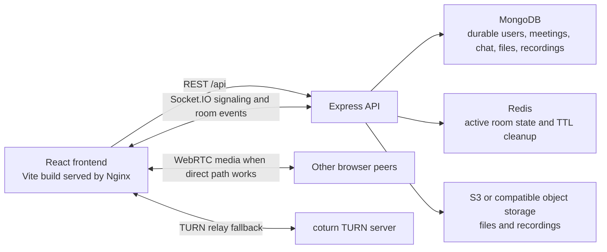

# Meetify

[](#verification)
[](#verification)
[](#verification)

Meetify is a full-stack meeting app built with React, Vite, Tailwind CSS, Express, MongoDB, Mongoose, Socket.IO, and JWT authentication.

It supports live video rooms, guest access, chat, screen sharing, whiteboard collaboration, shared files, collaborative code editing, host controls, meeting history, and optional recording uploads.

## Features

- Account signup, login, logout, and guest sessions
- Protected dashboard and meeting history routes
- Public meeting join flow with pre-join camera and microphone controls
- WebRTC video/audio rooms with Socket.IO signaling
- Host and co-host moderation controls
- Waiting room support
- Chat and private messages
- File upload and shared file viewing
- Collaborative whiteboard
- Collaborative code editor with saved code snapshots
- Screen sharing
- Host-controlled meeting recording with local save or opt-in upload
- Meeting history with participants, chat, shared files, recordings, and activity logs
- Centralized backend error responses and upload validation
- 404 page and reusable loading/error UI states

## Screenshots

Screenshots are not committed in this repository yet. Capture the home page, pre-join screen, live meeting room, whiteboard, code editor, and meeting history detail before publishing a public portfolio page.

## Tech Stack

- Frontend: React 19, Vite, React Router, Tailwind CSS, Axios, Socket.IO Client, Monaco Editor
- Backend: Node.js, Express 5, Socket.IO, Mongoose, MongoDB, Multer, JWT, bcrypt
- Upload storage: AWS S3 via AWS SDK v3, with local development fallback
- Tooling: npm workspaces-style scripts via root package, ESLint, Nodemon

## Architecture Summary

Meetify uses a React frontend for authenticated and guest meeting workflows, pre-join media controls, room UI, chat, file viewing, whiteboard drawing, code collaboration, and recording actions. The Express backend exposes REST endpoints for authentication, meeting lifecycle, history, chat retrieval, file metadata, and recording metadata. MongoDB is the durable persistence layer for users, meetings, chat, files, recordings, and activity logs.

Socket.IO coordinates realtime room membership, waiting-room decisions, moderation, chat delivery, shared file state, whiteboard updates, code editor sync, recording status, and WebRTC signaling. Redis stores active room state with expiring keys so reconnecting participants can recover transient state without making MongoDB responsible for fast-changing room data. WebRTC carries peer media directly between browsers when possible; TURN is configured as an ICE fallback for restrictive networks. S3 stores uploaded files and recordings in production, while Docker Compose can run a local fallback stack with MongoDB, Redis, coturn, the API server, and an Nginx-served React build.

## Production Architecture



- React frontend: renders the meeting product, manages WebRTC tracks, and calls REST/Socket.IO services through environment-configured URLs.
- Express backend: validates requests, normalizes errors, signs JWT cookies, and owns the REST and Socket.IO server surfaces.
- MongoDB persistence: stores account data, meeting records, chat history, file records, recording records, code snapshots, and activity logs.
- Redis active room state: stores transient participant, waiting-room, shared-file, recording, whiteboard, and code-editor state under `room:{meetingId}:...` keys.
- Socket.IO realtime coordination: broadcasts room state and forwards WebRTC `offer`, `answer`, and `ice-candidate` messages.
- WebRTC media flow: browsers exchange media peer-to-peer after Socket.IO signaling; backend does not process audio or video streams.
- TURN fallback: coturn relays media only when direct or STUN-assisted connectivity fails.
- S3 upload storage: production uploads use S3 URLs and metadata; local storage is limited to development and Docker fallback mode.
- Dockerized deployment: Compose defines `client`, `server`, `mongo`, `redis`, and `coturn` services for local production-like testing.

## Technical Metrics

These are source-counted implementation metrics, not performance benchmarks:

- API routes: 18 Express route handlers under `server/src/routes`.
- Socket.IO incoming handlers: 39 server-side `socket.on(...)` handlers, including disconnect cleanup.
- Automated tests: 59 defined tests total: 52 backend Jest tests, 5 client Node tests, and 2 Playwright e2e tests.
- Shared file upload limit: 25 MB.
- Recording upload limit: 500 MB.
- Redis TTL cleanup: active room keys are refreshed for 6 hours; ended or empty rooms are expired after 30 minutes.
- Docker services: 5 services: `client`, `server`, `mongo`, `redis`, and `coturn`.
- Backend statement coverage from the latest local run: 75.37%. This is a coverage metric, not a production performance number.

To measure runtime performance, add load tests for REST endpoints, Socket.IO room fanout, Redis operation latency, S3 upload latency, and WebRTC connection success rate by candidate type. Those numbers are not currently measured in this repo.

## Project Structure

```text
Meetify/
  client/                 React app
    src/components/       Shared and meeting-specific components
    src/context/          Auth, toast, and theme providers
    src/hooks/            WebRTC and room state logic
    src/pages/            Route pages
    src/services/         API and socket clients
  server/                 Express API and Socket.IO server
    src/config/           Database and CORS config
    src/controllers/      HTTP request handlers
    src/middleware/       Auth and error middleware
    src/models/           Mongoose models
    src/routes/           Express routes
    src/socket/           Realtime meeting handlers
    src/utils/            Shared backend helpers
```

## Requirements

- Node.js 20 or newer
- npm
- MongoDB, either local or hosted
- Redis for active realtime room state
- A modern browser with WebRTC support

## Environment Variables

Copy the examples before running locally:

```powershell
Copy-Item server\.env.example server\.env
Copy-Item client\.env.example client\.env
```

Client:

```env
VITE_API_URL=http://localhost:5000/api
VITE_SOCKET_URL=http://localhost:5000
VITE_STUN_URL=stun:stun.l.google.com:19302
VITE_TURN_URL=turn:your-domain.com:3478
VITE_TURN_USERNAME=your-turn-username
VITE_TURN_CREDENTIAL=your-turn-password
```

`VITE_STUN_URL` and `VITE_TURN_URL` accept comma-separated values. If the TURN URL or credentials are missing, Meetify falls back to STUN-only ICE configuration so local development still works.

Server:

```env
NODE_ENV=development
PORT=5000
CLIENT_URL=http://localhost:5173
MONGO_URI=mongodb://127.0.0.1:27017/meetify
REDIS_URL=redis://localhost:6379
JWT_SECRET=replace-with-a-long-random-secret
JWT_EXPIRES_IN=7d
JWT_COOKIE_EXPIRES_IN=7
STORAGE_PROVIDER=s3
LOCAL_UPLOADS_ENABLED=false
AWS_REGION=us-east-1
AWS_ACCESS_KEY_ID=replace-with-access-key-id
AWS_SECRET_ACCESS_KEY=replace-with-secret-access-key
AWS_S3_BUCKET=meetify-uploads
AWS_S3_PUBLIC_BASE_URL=https://meetify-uploads.s3.us-east-1.amazonaws.com
```

`CLIENT_URL` accepts a comma-separated list when multiple frontend origins need CORS access.
In development, the server falls back to `redis://localhost:6379` when `REDIS_URL` is not set. If Redis is unavailable, active room state uses an in-process fallback and the server logs a clear warning instead of crashing.

### Upload Storage

Meetify stores shared files and recording uploads in S3 when `STORAGE_PROVIDER=s3`. Uploaded MongoDB documents keep the existing `fileUrl` field as the frontend-facing URL and may also include `storageProvider`, `s3Key`, `bucket`, and `publicUrl`.

For local development without S3, set:

```env
STORAGE_PROVIDER=local
LOCAL_UPLOADS_ENABLED=true
```

Do not enable local uploads in production. Local files are served from `/uploads` only when `LOCAL_UPLOADS_ENABLED=true`.

The S3 bucket must either allow public reads for uploaded objects or be fronted by a CDN/custom public base URL set in `AWS_S3_PUBLIC_BASE_URL`. Minimum IAM permissions for the application role/user:

```json
{
  "Version": "2012-10-17",
  "Statement": [
    {
      "Effect": "Allow",
      "Action": [
        "s3:PutObject",
        "s3:GetObject"
      ],
      "Resource": "arn:aws:s3:::YOUR_BUCKET_NAME/meetify/*"
    }
  ]
}
```

## Setup

Install all dependencies from the repository root:

```bash
npm run install:all
```

Start frontend and backend together:

```bash
npm run dev
```

Run Redis locally before starting meetings:

```bash
docker run --name meetify-redis -p 6379:6379 redis:7-alpine
```

If the container already exists:

```bash
docker start meetify-redis
```

### TURN Server With coturn

Production WebRTC needs TURN for users behind restrictive NATs, corporate networks, or mobile carriers. Meetify reads TURN details from the client Vite environment and passes them to `RTCPeerConnection`; Socket.IO signaling event names and flow stay unchanged.

Install coturn on an Ubuntu server:

```bash
sudo apt update
sudo apt install coturn
```

Create or edit `/etc/turnserver.conf`:

```conf
listening-port=3478
tls-listening-port=5349
fingerprint
lt-cred-mech
realm=your-domain.com
server-name=your-domain.com
user=your-turn-username:your-turn-password
external-ip=YOUR_PUBLIC_SERVER_IP
min-port=49152
max-port=65535
no-loopback-peers
no-multicast-peers
```

Enable and start coturn:

```bash
sudo sed -i 's/#TURNSERVER_ENABLED=1/TURNSERVER_ENABLED=1/' /etc/default/coturn
sudo systemctl enable --now coturn
sudo systemctl status coturn
```

Open firewall/security-group ports:

- TCP/UDP `3478` for TURN
- TCP `5349` for TURN over TLS if configured
- UDP `49152-65535` for relayed media

Set the frontend environment:

```env
VITE_STUN_URL=stun:stun.l.google.com:19302
VITE_TURN_URL=turn:your-domain.com:3478
VITE_TURN_USERNAME=your-turn-username
VITE_TURN_CREDENTIAL=your-turn-password
```

Use `turns:your-domain.com:5349` when you configure coturn TLS certificates.

Run only one side:

```bash
npm run dev:client
npm run dev:server
```

Default local URLs:

- Client: `http://localhost:5173`
- API: `http://localhost:5000/api`
- Upload URLs: S3/CDN URLs when `STORAGE_PROVIDER=s3`, or `http://localhost:5000/uploads/...` when local development uploads are enabled

## Docker Setup

Docker is optional. The normal npm setup above still works unchanged. Use Docker Compose when you want a production-like local stack with the React build served by Nginx, the API in a Node container, MongoDB, Redis, and coturn.

Copy the Docker environment example if you want to customize values:

```bash
cp .env.docker.example .env
```

On Windows PowerShell:

```powershell
Copy-Item .env.docker.example .env
```

The default Compose values work without a `.env` file, but you should set a stronger `JWT_SECRET` before sharing the stack or testing with real accounts.

Start the full stack:

```bash
npm run docker:dev
```

Or directly:

```bash
docker compose up --build
```

Stop containers:

```bash
npm run docker:down
```

Follow logs:

```bash
npm run docker:logs
```

Docker URLs:

- Frontend: `http://localhost:5173`
- Backend API: `http://localhost:5000/api`
- MongoDB: `mongodb://localhost:27017/meetify`
- Redis: `redis://localhost:6379`
- TURN: `turn:localhost:3478`

The Docker frontend is built with:

```env
VITE_API_URL=/api
VITE_SOCKET_URL=http://localhost:5173
VITE_STUN_URL=stun:stun.l.google.com:19302
VITE_TURN_URL=turn:localhost:3478
VITE_TURN_USERNAME=meetify
VITE_TURN_CREDENTIAL=meetify-turn-password
```

Nginx serves the Vite build, falls back to `index.html` for React Router refreshes, and proxies `/api` plus `/socket.io` to the `server` service.

The server container uses:

```env
MONGO_URI=mongodb://mongo:27017/meetify
REDIS_URL=redis://redis:6379
CLIENT_URL=http://localhost:5173
STORAGE_PROVIDER=local
LOCAL_UPLOADS_ENABLED=true
AWS_REGION=us-east-1
AWS_ACCESS_KEY_ID=replace-with-access-key-id
AWS_SECRET_ACCESS_KEY=replace-with-secret-access-key
AWS_S3_BUCKET=meetify-uploads
AWS_S3_PUBLIC_BASE_URL=
```

For S3 testing, set `STORAGE_PROVIDER=s3`, `LOCAL_UPLOADS_ENABLED=false`, and replace the AWS placeholders in `.env`.

Persistent Docker volumes:

- `mongo_data` for MongoDB data
- `redis_data` for Redis append-only data
- `server_uploads` for local upload fallback files

Verify the Docker stack:

```bash
docker compose ps
docker compose logs server
docker compose exec mongo mongosh --quiet --eval "db.adminCommand('ping')"
docker compose exec redis redis-cli ping
```

Then open:

- Frontend: `http://localhost:5173`
- API health: `http://localhost:5000/api/health`

To check TURN locally:

```bash
docker compose logs coturn
```

Join a meeting in development and check the browser console for `[Meetify WebRTC] selected ICE candidate`. Candidate type `relay` means TURN is being used. For real cross-network TURN testing, set `TURN_EXTERNAL_IP` to the public IP of the machine running coturn and use a reachable domain/IP in `VITE_TURN_URL`.

Docker troubleshooting:

- If the frontend opens but API calls fail, confirm `client` and `server` are healthy with `docker compose ps`.
- If Socket.IO fails, confirm `/socket.io` is being proxied by Nginx and `CLIENT_URL` includes `http://localhost:5173`.
- If the server exits early, check `MONGO_URI`, `REDIS_URL`, and `JWT_SECRET` in `.env`.
- If uploads fail in Docker local mode, confirm `STORAGE_PROVIDER=local` and `LOCAL_UPLOADS_ENABLED=true`.
- If TURN does not produce relay candidates, verify ports `3478/tcp`, `3478/udp`, and `49152-49200/udp` are open and that the browser credentials match `TURN_USERNAME` and `TURN_PASSWORD`.

## Verification

All root-level aliases are available after `npm run install:all`:

```bash
npm run lint
npm run build
npm run test:client
npm run test:server
npm run test:e2e
```

Frontend lint:

```bash
npm run lint --prefix client
```

Frontend tests:

```bash
npm test --prefix client
```

Frontend production build:

```bash
npm run build --prefix client
```

Backend tests:

```bash
npm test --prefix server
```

Or from the repository root:

```bash
npm test
```

Backend API tests run with Jest and Supertest. Copy `server/.env.test.example` to `server/.env.test` when you want to override the defaults:

```powershell
Copy-Item server\.env.test.example server\.env.test
```

The test setup connects only to `MONGO_URI_TEST` or a MongoDB database whose name contains `test` or `jest`; by default it uses `mongodb://127.0.0.1:27017/meetify_test`. Collections are cleared before and after each test, and S3 upload calls are mocked so tests never require real AWS credentials or buckets. Redis is not required for the API tests.

Run only the Socket.IO integration tests:

```bash
npm run test:socket --prefix server
```

Socket tests start an in-process Socket.IO server on a random local port, connect real `socket.io-client` clients, mock Redis to use the deterministic room-state fallback, and call room-state cleanup after each test. They cover participant updates, chat, private messages, waiting room moderation, host controls, whiteboard, code editor, shared file state, recording state, and WebRTC signaling forwarding without creating browser media streams.

End-to-end browser tests:

```bash
npm run test:e2e
```

Interactive Playwright UI:

```bash
npm run test:e2e:ui
```

The Playwright config starts the backend on `http://127.0.0.1:5050` and serves the built frontend on `http://127.0.0.1:4173`. It uses `mongodb://127.0.0.1:27017/meetify_e2e_test` by default, local upload storage, fake browser media devices, and no real AWS S3 or production services. Override with `E2E_FRONTEND_URL`, `E2E_BACKEND_URL`, or `MONGO_URI_TEST` when needed. If browsers have not been installed on a machine yet, run:

```bash
npx playwright install chromium
```

Latest local verification summary:

- `npm run lint --prefix client`: passed with no errors; one Fast Refresh warning remains in an unused legacy UI toast component.
- `npm test --prefix client`: 5 tests passed.
- `npm test --prefix server`: 52 tests passed across 6 suites with 75.37% statement coverage.
- `npm run build --prefix client`: passed; Vite reports large chunk warnings from the meeting/Monaco bundle that should be optimized separately with code splitting.
- `npm run test:e2e`: 2 Chromium Playwright tests passed.

### WebRTC TURN Verification

To confirm TURN is being used:

1. Start the app with `VITE_TURN_URL`, `VITE_TURN_USERNAME`, and `VITE_TURN_CREDENTIAL` set.
2. Open two browsers or devices on different networks and join the same meeting.
3. In development mode, check the browser console for `[Meetify WebRTC] selected ICE candidate`. A `type` of `relay` means TURN is being used. `srflx` means STUN discovered a server-reflexive route, and `host` means direct local connectivity.
4. In Chrome, open `chrome://webrtc-internals`, select the Meetify peer connection, and inspect the selected candidate pair. The local candidate type should show `relay` when TURN is selected.

Common WebRTC troubleshooting:

- If no media connects, confirm Socket.IO connects first; signaling must work before ICE can complete.
- If users connect on the same Wi-Fi but fail across networks, verify TURN ports `3478` and UDP relay range `49152-65535` are open.
- If candidate type never becomes `relay` on restrictive networks, confirm the TURN username/password match coturn and that the coturn `realm` matches your deployed domain.
- If TLS TURN fails with `turns:`, confirm coturn has valid certificates and port `5349` is reachable.
- If calls connect one way only, check browser camera/microphone permissions and whether the network blocks UDP. Add a TCP TURN URL such as `turn:your-domain.com:3478?transport=tcp` as an additional comma-separated value when needed.

Server import smoke check:

```bash
cd server
node -e "import('./src/app.js').then(() => console.log('server app import ok'))"
```

## API Documentation

Base URL: `http://localhost:5000/api`

Authentication uses an HTTP-only `jwt` cookie and also accepts `Authorization: Bearer <token>` where supported.

### Health

`GET /health`

Returns service status.

### Auth

`POST /auth/register`

Body:

```json
{
  "name": "Ada Lovelace",
  "email": "ada@example.com",
  "password": "secret123",
  "avatar": ""
}
```

`POST /auth/login`

Body:

```json
{
  "email": "ada@example.com",
  "password": "secret123"
}
```

`POST /auth/logout`

Clears the auth cookie.

`GET /auth/me`

Returns the current authenticated user or `null`.

### Users

`GET /users/me`

Protected. Returns the authenticated user.

### Meetings

`POST /meetings/create`

Creates a live or scheduled meeting. Auth is optional; guests can create meetings.

Body:

```json
{
  "meetingId": "ABC-123-XYZ",
  "title": "Product sync",
  "name": "Host name",
  "isScheduled": false,
  "scheduledAt": null,
  "settings": {
    "waitingRoom": false,
    "allowChat": true,
    "allowScreenShare": true,
    "allowWhiteboard": true,
    "allowFileShare": true,
    "allowRecording": false
  }
}
```

`POST /meetings/join`

Joins or rejoins a meeting.

Body:

```json
{
  "meetingId": "ABC-123-XYZ",
  "name": "Participant name",
  "guestId": "optional-guest-id"
}
```

`GET /meetings/:meetingId`

Returns public meeting details used by the join flow.

`GET /meetings/history`

Protected. Returns recent meetings for the authenticated user.

`GET /meetings/history/:meetingId`

Protected. Returns meeting detail history, including chat, shared files, recordings, and activity logs.

### Chat

`GET /chat/:meetingId?userId=<id>`

Returns chat messages for a meeting. When `userId` is provided, private messages involving that user are included.

### Files

`POST /files/upload/:meetingId`

Multipart form field: `file`

Optional fields: `userId`, `name`, `socketId`

Limit: 25 MB. Supported types: PDF, DOC/DOCX, PPT/PPTX, GIF, JPEG, PNG, and WebP.

`GET /files/:meetingId`

Returns files shared in a meeting.

### Recordings

`POST /recordings/upload/:meetingId`

Multipart form field: `recording`

Optional fields: `durationSeconds`, `userId`, `name`, `socketId`

Uploads are opt-in. A stopped recording is kept locally in the browser until the host saves it locally, uploads it, or dismisses it.

Limit: 500 MB. Supported types: WEBM, MP4, M4A, and MP3.

`GET /recordings/:meetingId`

Returns uploaded recordings for a meeting.

## Socket Events

The client and server use Socket.IO for realtime meeting state.

Active meeting state is stored in Redis using keys such as `room:{meetingId}:state`, `room:{meetingId}:participants`, `room:{meetingId}:waiting`, `room:{meetingId}:whiteboard`, and `room:{meetingId}:code`. MongoDB remains the source of truth for permanent meeting history, chat, files, recordings, and activity logs.

Common meeting events:

- `join-room`
- `update-participants`
- `offer`
- `answer`
- `ice-candidate`
- `toggle-mic`
- `toggle-camera`
- `start-screen-share`
- `stop-screen-share`
- `screen-share-started`
- `screen-share-stopped`
- `send-message`
- `receive-message`
- `private-message`
- `file-uploaded`
- `open-shared-file`
- `close-shared-file`
- `whiteboard-draw`
- `whiteboard-clear`
- `whiteboard-undo`
- `code-state`
- `code-change`
- `language-change`
- `cursor-position`
- `recording-started`
- `recording-stopped`
- `end-meeting`

Manual Redis room-state check:

1. Start Redis, MongoDB, the server, and the client.
2. Open `http://localhost:5173` in one browser tab and create or join a meeting as the host.
3. Open the same meeting URL in a second browser tab as another participant.
4. Toggle mic/camera, raise a hand, open a shared file, draw on the whiteboard, or change code.
5. Confirm both tabs receive the same existing Socket.IO events and that Redis contains room keys, for example `redis-cli keys "room:*"`.
6. End the meeting and confirm participants leave the room; the room keys are left with a short cleanup TTL.

## Recording Notes

Meeting recording uses the browser `MediaRecorder` API with display capture. The host should select the Meetify tab or meeting window when prompted so the recording includes the video grid, whiteboard, code editor, shared files, and side panels.

Recordings are not uploaded automatically. This avoids unnecessary cloud storage use.

## Manual S3 Upload Testing

1. Create an S3 bucket and configure public read access, CloudFront, or another public base URL for uploaded objects.
2. Set `STORAGE_PROVIDER=s3`, `LOCAL_UPLOADS_ENABLED=false`, `AWS_REGION`, `AWS_S3_BUCKET`, and AWS credentials in `server/.env`.
3. Start MongoDB, Redis, the server, and the client.
4. Join a meeting and upload a supported file from the Files panel. Confirm the response and `GET /files/:meetingId` include an `https://...` `fileUrl`.
5. Start and stop a host recording, choose upload, and confirm `GET /recordings/:meetingId` includes an `https://...` `fileUrl`.
6. Open both returned URLs in the browser and confirm the file/recording is reachable.
7. Try an unsupported extension/MIME type and a file over the documented limit; the API should return normalized JSON with `message` and `error`.

## Deployment Notes

- Use HTTPS for the frontend, backend, Socket.IO, and TURN/TURNS endpoints in production. Browser media APIs and secure cookies both depend on secure origins outside localhost.
- Set a strong `JWT_SECRET`, production `CLIENT_URL` origins, `MONGO_URI`, `REDIS_URL`, S3 bucket settings, and TURN credentials through the deployment platform rather than committing `.env` files.
- Keep `STORAGE_PROVIDER=s3` and `LOCAL_UPLOADS_ENABLED=false` for real production deployments. Local upload serving is intended only for development and Docker fallback testing.
- Configure S3 bucket access deliberately: either public object reads for uploaded meeting assets, a CDN such as CloudFront, or another public base URL in `AWS_S3_PUBLIC_BASE_URL`.
- Run MongoDB and Redis as managed or backed-up services for production. Redis stores transient active-room state, while MongoDB stores the durable meeting history.
- Deploy coturn with a public IP or reachable hostname. Open TCP/UDP `3478`, optional TCP `5349` for TLS TURN, and the configured UDP relay range.
- Use a process manager or container orchestrator with health checks. The Docker server health check calls `/api/health`; the client health check validates the Nginx-served frontend.
- Add observability before real users: request logs, error tracking, Socket.IO connection counts, Redis health, MongoDB health, S3 upload failures, and WebRTC candidate-type diagnostics.

### Vercel Frontend + Render Backend

Recommended split deployment:

- Vercel project root directory: `client`
- Vercel build command: `npm run build`
- Vercel output directory: `dist`
- Render service root directory: `server`
- Render build command: `npm ci`
- Render start command: `npm start`
- Render health check path: `/api/health`

The repo includes [client/vercel.json](client/vercel.json) for React Router fallback rewrites and [render.yaml](render.yaml) for a Render backend blueprint.

Vercel environment variables:

```env
VITE_API_URL=https://YOUR_RENDER_SERVICE.onrender.com/api
VITE_SOCKET_URL=https://YOUR_RENDER_SERVICE.onrender.com
VITE_STUN_URL=stun:stun.l.google.com:19302
VITE_TURN_URL=turn:YOUR_TURN_DOMAIN:3478
VITE_TURN_USERNAME=your-turn-username
VITE_TURN_CREDENTIAL=your-turn-password
```

Render environment variables:

```env
NODE_ENV=production
CLIENT_URL=https://YOUR_VERCEL_PROJECT.vercel.app
MONGO_URI=mongodb+srv://...
REDIS_URL=rediss://...
JWT_SECRET=replace-with-a-long-random-secret
JWT_EXPIRES_IN=7d
JWT_COOKIE_EXPIRES_IN=7
STORAGE_PROVIDER=s3
LOCAL_UPLOADS_ENABLED=false
AWS_REGION=us-east-1
AWS_ACCESS_KEY_ID=replace-with-access-key-id
AWS_SECRET_ACCESS_KEY=replace-with-secret-access-key
AWS_S3_BUCKET=meetify-uploads
AWS_S3_PUBLIC_BASE_URL=https://meetify-uploads.s3.us-east-1.amazonaws.com
```

When deployment URLs change, update provider environment variables instead of changing code:

- Backend URL changed: update Vercel `VITE_API_URL` and `VITE_SOCKET_URL`, then redeploy the Vercel project. Vite variables are build-time values, so a Vercel redeploy is required, but no commit is required.
- Frontend URL changed: update Render `CLIENT_URL`, then restart or redeploy the Render service. `CLIENT_URL` can contain comma-separated origins for preview and production domains.
- TURN details changed: update Vercel `VITE_TURN_URL`, `VITE_TURN_USERNAME`, and `VITE_TURN_CREDENTIAL`, then redeploy Vercel.
- S3, MongoDB, Redis, or JWT values changed: update Render environment variables, then restart or redeploy Render.

Auth works with production cookies and also sends the returned JWT as an `Authorization: Bearer ...` fallback from the frontend. This helps across Vercel/Render domains where browsers may restrict third-party cookies.

## Error Handling

The backend normalizes common errors into JSON responses:

```json
{
  "message": "Request body contains invalid JSON"
}
```

In development, server stack traces are included. In production, stack traces are omitted.

## Known Limitations

- WebRTC is peer-to-peer. The backend does not provide SFU/MCU media mixing, adaptive forwarding, or server-side recording, so large meetings may need a media server architecture.
- Host recording uses the browser `MediaRecorder` and display-capture flow. It depends on browser support and user selection of the correct tab/window.
- S3 upload success depends on bucket/CDN readability or a correct `AWS_S3_PUBLIC_BASE_URL`; the app does not currently generate signed download URLs.
- Redis has an in-memory fallback for development/test resilience, but production should run Redis and monitor connection health.
- Authentication covers app accounts and guests, but there is no email delivery integration for OTP/password flows in this repository.
- E2E tests use fake media devices and local services; they do not prove real camera/microphone, NAT traversal, or TURN relay success across separate networks.
- Runtime performance, maximum room size, and WebRTC success rates are not benchmarked. Measure them with load tests, browser telemetry, and TURN/STUN candidate analytics before claiming scale numbers.

## Resume Bullets

- Built a full-stack video meeting platform with React, Express, MongoDB, Socket.IO, and WebRTC, supporting authenticated and guest rooms, chat, screen sharing, whiteboard collaboration, file sharing, code editing, moderation, meeting history, and recording uploads.
- Implemented production-oriented infrastructure with Redis-backed active room state, S3 upload storage with local fallback, coturn TURN configuration for restrictive networks, Docker Compose services, centralized error handling, upload validation, and automated Jest/Node/Playwright test coverage.
- Designed realtime coordination flows for participant state, waiting-room approval, host controls, shared files, whiteboard strokes, code snapshots, recording status, and WebRTC signaling while keeping durable history in MongoDB and transient state in Redis.

## Interview Questions

1. Why use Redis if MongoDB already stores meeting data?

Redis holds fast-changing active room state such as participants, waiting-room entries, shared-file state, whiteboard strokes, code editor state, and recording status. MongoDB remains the durable source for users, meeting history, chat, files, recordings, and activity logs. This keeps high-churn realtime state out of the primary database and lets room state expire automatically.

2. How does WebRTC media flow through Meetify?

Socket.IO is used for signaling only: clients exchange `offer`, `answer`, and `ice-candidate` messages through the server. After ICE negotiation, media flows directly between browsers when possible. If direct connectivity fails, configured TURN servers relay the media. The Express backend does not process audio or video streams.

3. How are uploads handled safely?

Multer enforces size limits, shared files are capped at 25 MB, recordings at 500 MB, and validation checks file extension plus MIME type. Production storage uses S3 metadata and public/CDN URLs. Local upload serving is explicitly limited to development fallback mode.

4. What happens when the last participant leaves a room?

The Socket.IO disconnect cleanup removes the participant from Redis-backed room state. If no participants remain, the room state is not kept forever; its keys are set to expire after the ended-room TTL of 30 minutes. Active rooms refresh their Redis TTL to 6 hours.

5. What would you improve before scaling this to larger meetings?

The main scaling step would be adding an SFU for media routing because peer-to-peer WebRTC becomes expensive as room size grows. I would also add Socket.IO Redis adapters for multi-instance fanout, signed S3 downloads, production email delivery, stronger observability, load tests, and WebRTC telemetry for candidate type and connection quality.

## Resume-Ready Description

Meetify is a production-oriented MERN video meeting platform that combines React, Express, MongoDB, Socket.IO, Redis, WebRTC, S3, TURN, and Docker. It supports authenticated and guest meetings, realtime chat, screen sharing, whiteboard collaboration, shared files, collaborative code editing, host moderation, meeting history, and optional recording uploads, with Redis-backed active room state and MongoDB-backed durable history.

## Development Notes

- Keep feature logic close to its route/component unless it is reused.
- Use `server/src/utils/normalizeMeetingId.js` for backend meeting ID normalization.
- Use `client/src/services/` for frontend API calls.
- Add comments only when the code needs context that is not obvious from naming.
